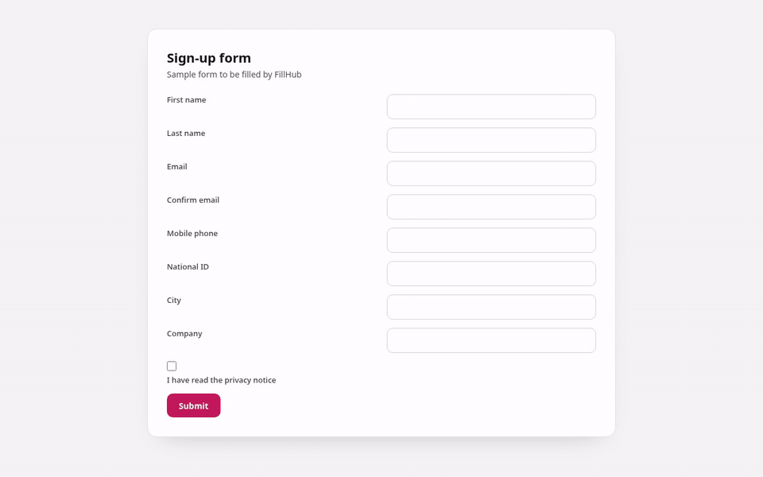
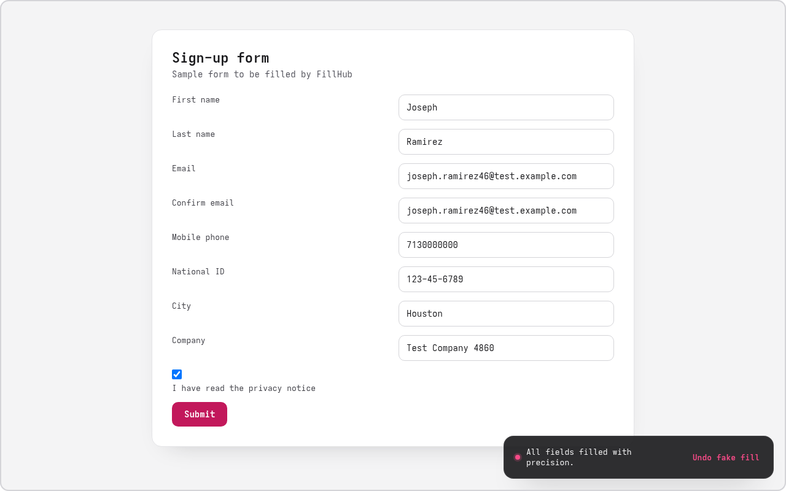
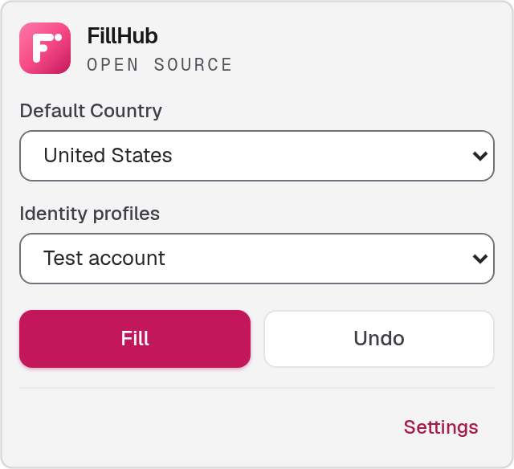
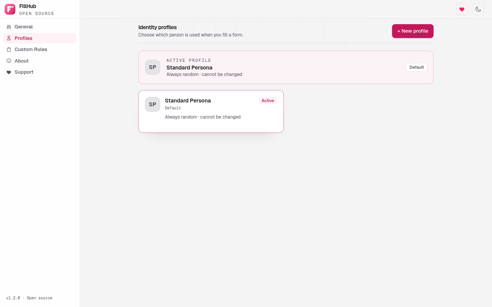
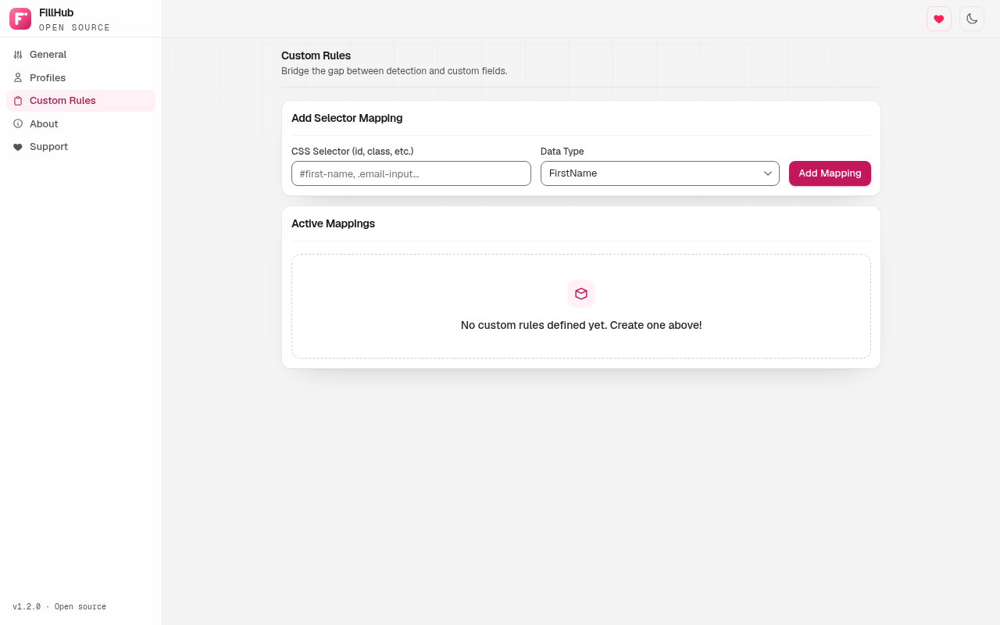
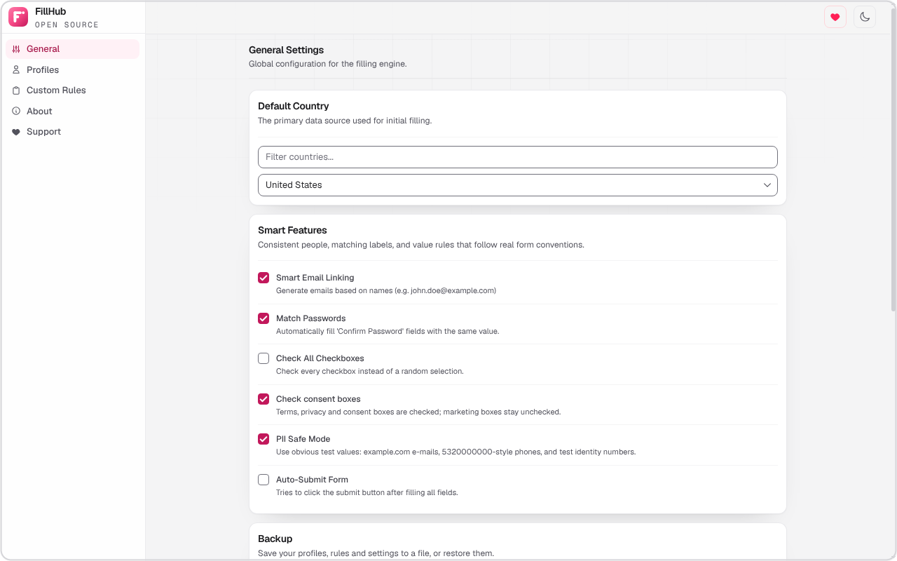
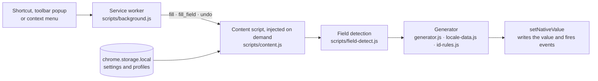

<p align="center">
  
</p>

<p align="center">
  <b>Realistic, consistent fake data for web forms, in 15 languages.</b><br>
  A Chrome extension for developers and testers. Privacy-safe by default. No data collection.
</p>

<p align="center">
  <a href="https://chromewebstore.google.com/detail/fillhub/chkkiamcnmilalgbokfofnhhlckmaihi"></a>
  <a href="https://github.com/kilicberkay/FillHub/releases/latest"></a>
  <a href="https://github.com/kilicberkay/FillHub/actions/workflows/ci.yml"></a>
  <a href="LICENSE"></a>
  
  <a href="https://github.com/sponsors/kilicberkay"></a>
</p>

<p align="center">
  English · <a href="README.tr.md">Türkçe</a>
</p>

<p align="center">
  <a href="#install">Install</a> · <a href="#features">Features</a> · <a href="#screenshots">Screenshots</a> · <a href="docs/FAQ.md">FAQ</a> · <a href="#development">Development</a>
</p>

<p align="center">
  <a href="docs/videos/demo-en.mp4"></a><br>
  <sub><a href="docs/videos/demo-en.mp4">▶ Watch the full-quality video (MP4, 1280×800)</a></sub>
</p>

| Languages | Consistency | Shortcuts | Data |
|---|---|---|---|
| 15 countries | One consistent person per fill | `Ctrl+Shift+F` fills, `Ctrl+Shift+U` undoes | None collected |

---

## Contents

- [What it does](#what-it-does)
- [Screenshots](#screenshots)
- [Features](#features)
- [Install](#install)
- [Use](#use)
- [How the data is made](#how-the-data-is-made)
- [Privacy and safety](#privacy-and-safety)
- [How it works](#how-it-works)
- [Development](#development)
- [Contributing and security](#contributing-and-security)
- [Support](#support)
- [License](#license)

## What it does

FillHub fills the fields of a web form in one action. It reads each field's label, name, and type, then writes a value that fits: a name for a name field, a phone number in the right country format for a phone field, a checksum-valid test number for an ID field.

Every fill creates **one consistent person**. The first name, last name, e-mail, the "confirm e-mail" field, the username, and the phone number all belong to the same person, so flows that compare values (a sign-up that checks the e-mail twice, for example) behave the way they would with a real user.

<p align="center">
  
</p>

## Screenshots

<table align="center" width="100%">
  <tr>
    <td align="center" width="50%">
      <picture>
        <source media="(prefers-color-scheme: dark)" srcset="docs/images/dark/popup.png">
        
      </picture><br>
      <sub>Toolbar popup</sub>
    </td>
    <td align="center" width="50%">
      <picture>
        <source media="(prefers-color-scheme: dark)" srcset="docs/images/dark/settings-profiles.png">
        
      </picture><br>
      <sub>Identity profiles</sub>
    </td>
  </tr>
  <tr>
    <td align="center" width="50%">
      <picture>
        <source media="(prefers-color-scheme: dark)" srcset="docs/images/dark/settings-rules.png">
        
      </picture><br>
      <sub>Custom rules</sub>
    </td>
    <td align="center" width="50%">
      <picture>
        <source media="(prefers-color-scheme: dark)" srcset="docs/images/dark/settings-general.png">
        
      </picture><br>
      <sub>General settings</sub>
    </td>
  </tr>
</table>

## Features

### One-action form filling

Press `Ctrl+Shift+F` (`Command+Shift+F` on macOS), open the toolbar popup and press **Fill**, or choose **Fill form with fake data** from the right-click menu. The popup also lets you pick the default country and profile. A single field can be filled with **Fill this field**, and **Undo** restores the form to the state it had before the last fill.

### Fifteen languages, fifteen countries

Names, cities, postal codes, phone numbers, companies, and identity numbers follow the format of the country profile you choose.

| Language | Country profile | Language | Country profile |
|---|---|---|---|
| English | United States | Hindi | India |
| Turkish | Türkiye | Bengali | Bangladesh |
| Spanish | Mexico | Urdu | Pakistan |
| French | France | Indonesian | Indonesia |
| German | Germany | Vietnamese | Vietnam |
| Portuguese | Brazil | Arabic | Egypt |
| Russian | Russia | Chinese | China |
| Japanese | Japan | | |

Russian surnames are declined by gender. Names in non-Latin scripts come with Latin spellings that are used for e-mail addresses.

### PII Safe mode

PII Safe is **on by default**. It replaces personal identifiers with values that are obviously test data. The examples below are for Türkiye (`tr-TR`):

| Field | PII Safe on | PII Safe off |
|---|---|---|
| Name | Mixed names from the language pools | Same pools |
| E-mail | `ayse.demir47@example.com` (test domains only) | A realistic-looking address on a generic domain, e.g. `ayse.demir47@mail.com` |
| Phone | `5320000000` (operator prefix followed by zeros) | `5320478545` (realistic) |
| National ID | `11111111110` (checksum-valid test number) | A random checksum-valid number |
| Company and website | `Test Şirketi 4821`, `https://www.example.org` | Names from the country's company list |

### Smart field detection

Each field is classified from its `autocomplete` value, `type`, label, `name` and `id`, placeholder, and nearby text. The detection corpus covers more than 100 labels across the 15 languages, including tricky ones such as `Soyadınız` (surname), which must not be read as a first name. Select boxes are matched to the country, state, and phone-code options they contain.

### Identity profiles

A profile decides who is used for a fill:

- **Random on every fill** (the default): a new, consistent person each time.
- **Fixed person**: the same person every time, with a button to generate another one.

Create, edit, and switch profiles on the **Profiles** page. The active profile is always shown at the top.

### Custom rules

When built-in detection misses a field, map a CSS selector to a data type on the **Custom Rules** page. Rules are checked in order and the first match wins. **Test on this page** in the toolbar popup shows how many fields a selector matches before you fill anything.

### Smart form behavior

- **Smart e-mail linking**: e-mail fields follow the generated name.
- **Match passwords**: "confirm password" fields receive the same value.
- **Consent checkboxes** (terms, privacy, KVKK) are checked, and **marketing checkboxes** (newsletter, campaigns) stay unchecked. Required boxes are always checked. Other boxes are set at random, unless **Check all checkboxes** is on. Turn off **Check consent boxes** to use the random policy for consent boxes too.
- **Radio groups** receive exactly one choice.
- **HTML constraints** are respected: `pattern`, `minlength`, and the `min` and `max` limits of date and time fields.
- **Date fields** receive dates between 2000 and today.
- **Text fields** receive sample sentences in the language of the country profile. Long sentences go into multi-line fields, and values are cut to the field's `maxlength`.
- **URL fields** receive links to reserved example domains, never to real sites.
- **File inputs** receive a generated file.
- **Auto-submit** (off by default) clicks the real submit button after filling. Fake buttons and destructive controls such as Cancel or Delete are never clicked.
- **Works inside iframes**, skips disabled and read-only fields, and keeps framework state (React, Vue) in sync with the values it writes.

### Captchas are never clicked

FillHub does not click, solve, or call captcha APIs. When a visible reCAPTCHA, hCaptcha, or Turnstile widget is on the page, FillHub outlines it, shows a notice, and leaves the verification to you. It never scrolls the page to the captcha or moves focus there.

### Settings

- **General**: default country, smart features, and PII Safe mode.
- **Profiles**: identity profiles (see above).
- **Custom Rules**: selector-to-type rules.
- **About**: version and project information.
- **Support**: how to support the project.

## Install

### Chrome Web Store (recommended)

**[Add FillHub to Chrome](https://chromewebstore.google.com/detail/fillhub/chkkiamcnmilalgbokfofnhhlckmaihi)**

### From source (developer mode)

1. Clone the repository, or download [`fillhub-1.3.2.zip`](https://github.com/kilicberkay/FillHub/releases/tag/v1.3.2) from the Releases page and unpack it.
2. Open `chrome://extensions` and turn on **Developer mode**.
3. Click **Load unpacked** and select the `extension/` folder (the one that contains `manifest.json`).
4. Open any page with a form and press `Ctrl+Shift+F`.

Requires Chrome 116 or newer, or another Chromium-based browser that supports Manifest V3.

## Use

| Action | Shortcut | Menu or toolbar |
|---|---|---|
| Fill the whole form | `Ctrl+Shift+F` (macOS: `Command+Shift+F`) | Toolbar popup → *Fill*, or right-click → *Fill form with fake data* |
| Fill the focused field | none | Right-click a field → *Fill this field* |
| Chaos mode (unusual values for fuzz tests) | `Ctrl+Shift+Y` | none |
| Undo the last fill | `Ctrl+Shift+U` | Right-click → *Undo fake fill* |

Shortcuts can be changed at `chrome://extensions/shortcuts`.

## How the data is made

Each fill goes through four steps:

1. **Locale.** The default country and language select the pools for names, cities, companies, and street names.
2. **Person.** One person is created for the fill, or taken from the fixed profile. It holds the names, city, postal code, phone, identity numbers, company, and e-mail local part.
3. **Field.** Each field is classified and receives a value of the right type. Format rules such as `pattern` and `minlength` are applied first.
4. **Consistency.** Values that refer to the same thing, such as the e-mail and its confirmation field, come from the same person.

### Identity numbers and how they are verified

FillHub can produce identity numbers that pass the public checksum of their country. A passing checksum does not mean the number belongs to anyone.

| Identity | Country | Verification |
|---|---|---|
| TC Kimlik No (TCKN) | Türkiye | Checksum, checked against known test vectors |
| CPF | Brazil | Checksum |
| CNPJ | Brazil | Checksum |
| Resident identity number | China | Checksum |
| SNILS | Russia | Checksum |
| INN (10 digits) | Russia | Checksum |
| My Number | Japan | Checksum |
| NIR | France | Checksum |
| CURP | Mexico | Checksum |
| Aadhaar | India | Checksum (Verhoeff) |
| IBAN | Many countries | Checksum (mod 97) |
| INN (12 digits) | Russia | Algorithm only; not checked against a known vector |
| VKN, SSN, EIN, and other official numbers | Various | Format only; validity is not claimed |

## Privacy and safety

- **No data collection.** FillHub has no analytics, telemetry, accounts, or servers. Nothing leaves your browser.
- **Settings stay local**, in `chrome.storage.local`.
- **Minimal permissions**: `storage` (settings), `contextMenus` (right-click items), `scripting` (injects the fill scripts only when you start a fill), and `activeTab` (the tab you are looking at, only after you press a shortcut, a popup button, or a menu item). There is no access to all sites, and nothing runs on pages you do not fill.
- **Generated data is for testing.** PII Safe mode is on by default. Do not use generated data for real applications, purchases, or identity claims.

Full policy: [PRIVACY.md](PRIVACY.md).

## How it works



The design is described in [docs/ARCHITECTURE.md](docs/ARCHITECTURE.md).

## Development

**Requirements:** Node.js 20 or newer. The extension itself has no build step and no runtime dependencies. npm is used only for development tools: the Tailwind CLI that builds the settings page CSS, and the test runner.

```bash
npm ci
npm test              # every check, including the browser tests (needs Chromium)
npm run test:quick    # every check except the browser tests
npm run build         # dist/fillhub-<version>.zip for the Chrome Web Store
npm run build:css     # regenerate options/options.css after UI changes
```

The browser tests use Chromium from `CHROME_BIN`, from `PLAYWRIGHT_BROWSERS_PATH`, or from the default Playwright cache. Without a browser they are skipped.

<details>
<summary><b>Project layout</b></summary>

```
FillHub/
├── extension/           The extension itself; this folder is what gets packaged
│   ├── manifest.json    Manifest V3: name, permissions, shortcuts
│   ├── _locales/        Localized name, description, shortcut and menu texts (15 languages)
│   ├── scripts/         Service worker, content scripts, generator, detection, data
│   ├── options/         Settings page: HTML, JavaScript, translations, Tailwind source and output
│   ├── popup/           Toolbar popup: country, profile, Fill and Undo
│   └── icons/           Toolbar and store icons (vector source: logo.svg)
├── tests/               Unit tests (tests/unit) and browser tests (tests/e2e)
├── tools/               Syntax check, data verification, zip build, store image generator
├── store/               Chrome Web Store listing text, privacy text, and store images
├── docs/                Architecture, FAQ, translation guide, third-party notices, README images
├── .github/             CI and release workflows, templates, contributing guide, code of conduct, security policy
├── README.md            English README (README.tr.md is the Turkish one)
├── CHANGELOG.md         Release history
├── PRIVACY.md           Privacy policy
├── LICENSE              MIT license
├── AGENTS.md            Notes for AI coding agents working on this repository
└── package.json         Development tools (npm); the extension itself has no dependencies
```

</details>

## Documentation

- [FAQ](docs/FAQ.md): common questions, including captchas, PII Safe, and consent boxes.
- [Architecture](docs/ARCHITECTURE.md): how the pieces fit together.
- [Translating](docs/TRANSLATING.md): how to improve or add translations.

## Contributing and security

- Contributions are welcome. Start with [CONTRIBUTING.md](.github/CONTRIBUTING.md) and follow the [Code of Conduct](.github/CODE_OF_CONDUCT.md).
- Report security problems privately, through the **Security** tab (*Report a vulnerability*). See [SECURITY.md](.github/SECURITY.md).

## Support

FillHub is free and open source. If it saves you time, you can support its development on [GitHub Sponsors](https://github.com/sponsors/kilicberkay). Support is never required.

## License

[MIT](LICENSE) © 2025-2026 Berkay Kılıç. Third-party notices, including the Geist font (SIL OFL 1.1), are in [THIRD_PARTY_NOTICES.md](docs/THIRD_PARTY_NOTICES.md).
