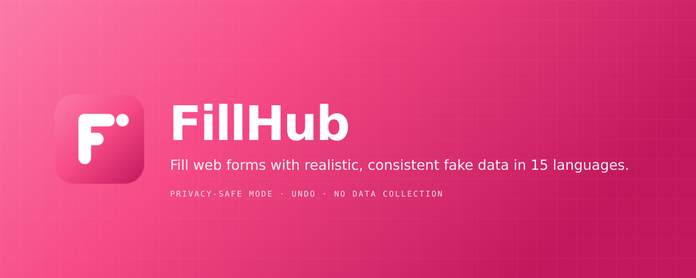
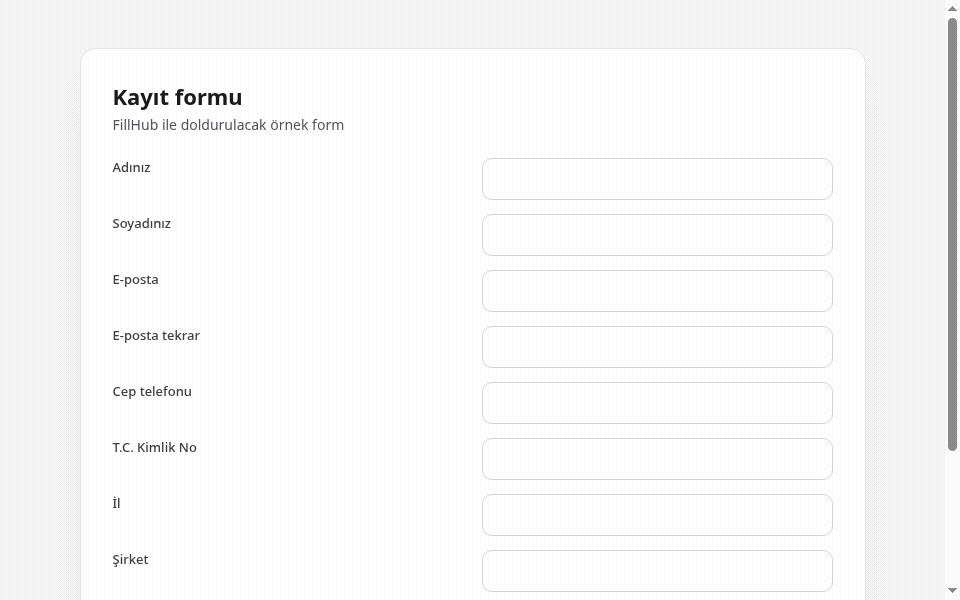
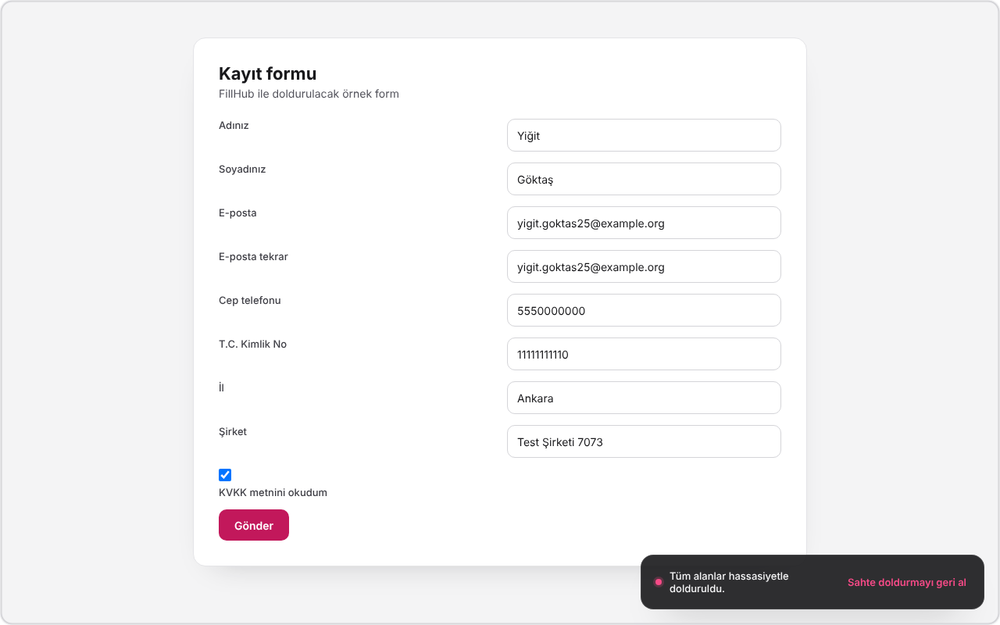
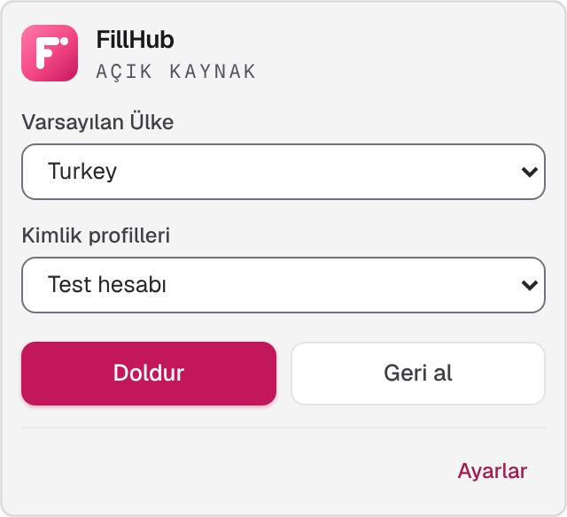
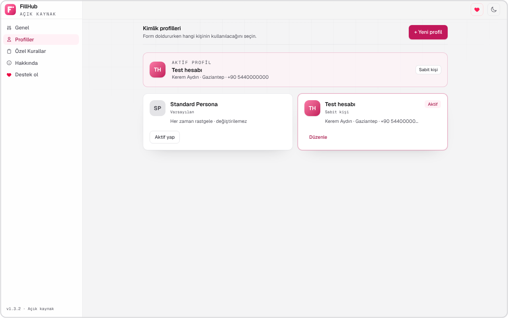
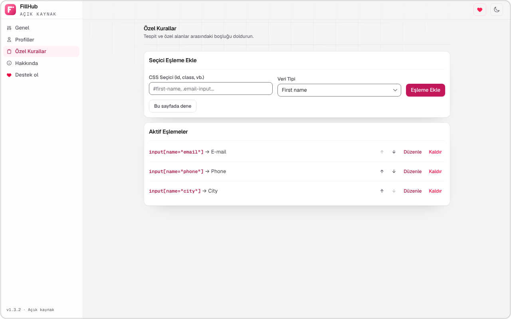
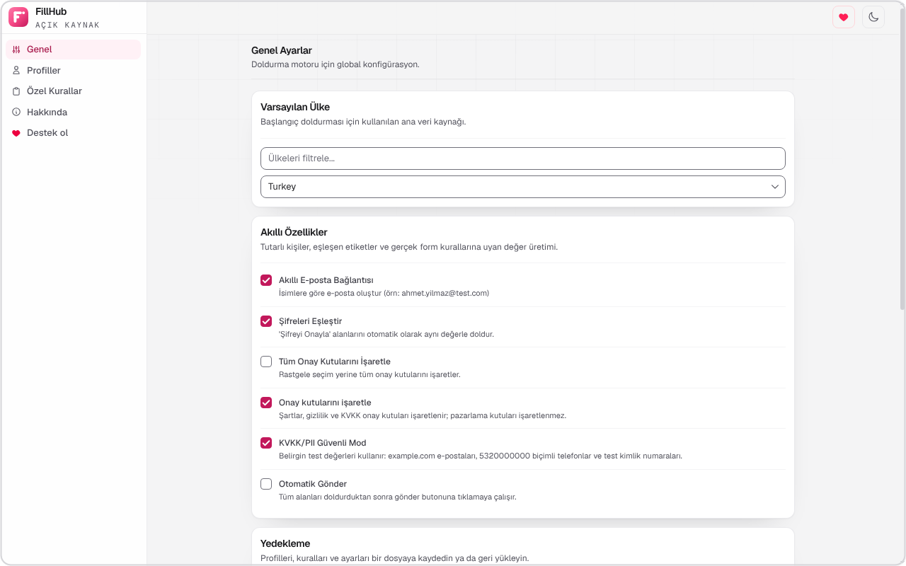
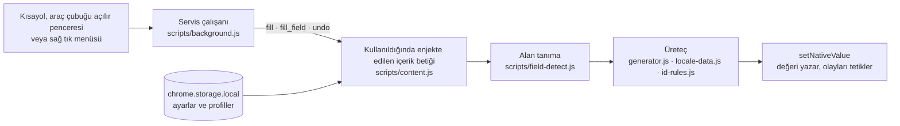

<p align="center">
  
</p>

<p align="center">
  <b>Web formları için 15 dilde gerçekçi ve tutarlı sahte veri.</b><br>
  Geliştiriciler ve test uzmanları için bir Chrome eklentisi. Varsayılan olarak gizlilik odaklı. Veri toplamaz.
</p>

<p align="center">
  <a href="https://chromewebstore.google.com/detail/fillhub/chkkiamcnmilalgbokfofnhhlckmaihi"></a>
  <a href="https://github.com/kilicberkay/FillHub/releases/latest"></a>
  <a href="https://github.com/kilicberkay/FillHub/actions/workflows/ci.yml"></a>
  <a href="LICENSE"></a>
  
  <a href="https://github.com/sponsors/kilicberkay"></a>
</p>

<p align="center">
  <a href="README.md">English</a> · Türkçe
</p>

<p align="center">
  <a href="#kurulum">Kurulum</a> · <a href="#özellikler">Özellikler</a> · <a href="#ekran-görüntüleri">Ekran görüntüleri</a> · <a href="docs/FAQ.md">SSS</a> · <a href="#geliştirme">Geliştirme</a>
</p>

<p align="center">
  <a href="docs/videos/demo-tr.mp4"></a><br>
  <sub><a href="docs/videos/demo-tr.mp4">▶ Tam kaliteli videoyu izle (MP4, 1280×800)</a></sub>
</p>

| Diller | Tutarlılık | Kısayollar | Veri |
|---|---|---|---|
| 15 ülke | Her doldurmada tek ve tutarlı bir kişi | `Ctrl+Shift+F` doldurur, `Ctrl+Shift+U` geri alır | Toplanmaz |

---

## İçindekiler

- [Ne yapar](#ne-yapar)
- [Ekran görüntüleri](#ekran-görüntüleri)
- [Özellikler](#özellikler)
- [Kurulum](#kurulum)
- [Kullanım](#kullanım)
- [Veri nasıl üretilir](#veri-nasıl-üretilir)
- [Gizlilik ve güvenlik](#gizlilik-ve-güvenlik)
- [Nasıl çalışır](#nasıl-çalışır)
- [Geliştirme](#geliştirme)
- [Katkı ve güvenlik](#katkı-ve-güvenlik)
- [Destek](#destek)
- [Lisans](#lisans)

## Ne yapar

FillHub, bir web formunun alanlarını tek işlemle doldurur. Her alanın etiketini, adını ve türünü okur, ona uygun bir değer yazar: ad alanına bir ad, telefon alanına seçilen ülkenin biçimine uygun bir telefon numarası, kimlik alanına sağlaması geçerli bir test numarası.

Her doldurma **tutarlı tek bir kişi** üretir. Ad, soyad, e-posta, "e-postayı tekrar yazın" alanı, kullanıcı adı ve telefon aynı kişiye aittir. Değerleri karşılaştıran akışlar (örneğin e-postayı iki kez isteyen bir kayıt) gerçek bir kullanıcıyla olduğu gibi davranır.

<p align="center">
  
</p>

## Ekran görüntüleri

<table align="center" width="100%">
  <tr>
    <td align="center" width="50%">
      <picture>
        <source media="(prefers-color-scheme: dark)" srcset="docs/images/tr/dark/popup.png">
        
      </picture><br>
      <sub>Araç çubuğu açılır penceresi</sub>
    </td>
    <td align="center" width="50%">
      <picture>
        <source media="(prefers-color-scheme: dark)" srcset="docs/images/tr/dark/settings-profiles.png">
        
      </picture><br>
      <sub>Kimlik profilleri</sub>
    </td>
  </tr>
  <tr>
    <td align="center" width="50%">
      <picture>
        <source media="(prefers-color-scheme: dark)" srcset="docs/images/tr/dark/settings-rules.png">
        
      </picture><br>
      <sub>Özel kurallar</sub>
    </td>
    <td align="center" width="50%">
      <picture>
        <source media="(prefers-color-scheme: dark)" srcset="docs/images/tr/dark/settings-general.png">
        
      </picture><br>
      <sub>Genel ayarlar</sub>
    </td>
  </tr>
</table>

## Özellikler

### Tek işlemle form doldurma

`Ctrl+Shift+F` (macOS'ta `Command+Shift+F`) tuşlarına basın, araç çubuğundaki simgeyi açıp **Doldur** düğmesine basın ya da sağ tık menüsünden **Formu sahte verilerle doldur** seçeneğini kullanın. Açılır pencerede varsayılan ülke ve profili de seçebilirsiniz. Tek bir alan için **Bu alanı doldur** seçeneği vardır. **Geri al**, son doldurmadan önceki hâli geri yükler.

### 15 dil, 15 ülke

Ad, şehir, posta kodu, telefon, şirket ve kimlik numaraları seçilen ülke profilinin biçimini izler.

| Dil | Ülke profili | Dil | Ülke profili |
|---|---|---|---|
| İngilizce | Amerika Birleşik Devletleri | Hintçe | Hindistan |
| Türkçe | Türkiye | Bengalce | Bangladeş |
| İspanyolca | Meksika | Urduca | Pakistan |
| Fransızca | Fransa | Endonezyaca | Endonezya |
| Almanca | Almanya | Vietnamca | Vietnam |
| Portekizce | Brezilya | Arapça | Mısır |
| Rusça | Rusya | Çince | Çin |
| Japonca | Japonya | | |

Rusça soyadları cinsiyete göre çekimlenir. Latin alfabesi dışındaki adlar, e-posta adreslerinde kullanılan Latin karşılıklarıyla birlikte gelir.

### Güvenli mod (PII Safe)

Güvenli mod **varsayılan olarak açıktır**. Kişisel tanımlayıcıları, test verisi olduğu açıkça belli olan değerlerle değiştirir. Aşağıdaki örnekler Türkiye (`tr-TR`) içindir:

| Alan | Güvenli mod açık | Güvenli mod kapalı |
|---|---|---|
| Ad | Dil havuzlarından karışık adlar | Aynı havuzlar |
| E-posta | `ayse.demir47@example.com` (yalnızca test alan adları) | Gerçekçi görünümlü bir adres, genel bir alan adında; örneğin `ayse.demir47@mail.com` |
| Telefon | `5320000000` (operatör öneki ve sıfırlar) | `5320478545` (gerçekçi) |
| TC Kimlik No | `11111111110` (sağlaması geçerli test numarası) | Rastgele, sağlaması geçerli bir numara |
| Şirket ve web sitesi | `Test Şirketi 4821`, `https://www.example.org` | Ülkenin şirket listesinden adlar |

### Akıllı alan tanıma

Her alan; `autocomplete` değeri, `type`, etiket, `name` ve `id`, placeholder ve çevredeki metinden sınıflandırılır. Tanıma korpusu 15 dildeki 100'den fazla etiketi kapsar; bunların arasında `Soyadınız` (soyad) gibi, ad olarak okunmaması gereken zor etiketler de vardır. Açılır listeler, içerdikleri ülke, il ve telefon kodu seçenekleriyle eşleştirilir.

### Kimlik profilleri

Bir profil, doldurmada kimin kullanılacağını belirler:

- **Her doldurmada rastgele** (varsayılan): her seferinde yeni ve tutarlı bir kişi.
- **Sabit kişi**: her seferinde aynı kişi; isterseniz "başka kişi üret" ile yenisini oluşturabilirsiniz.

Profilleri **Profiller** sayfasında oluşturun, düzenleyin ve değiştirin. Aktif profil her zaman en üstte gösterilir.

### Özel kurallar

Yerleşik tanıma bir alanı kaçırırsa, **Özel Kurallar** sayfasında bir CSS seçicisini bir veri türüne eşleyebilirsiniz. Kurallar sırayla denenir ve ilk eşleşen kazanır. **Bu sayfada dene** düğmesi, doldurmadan önce seçicinin kaç alanla eşleştiğini gösterir.

### Akıllı form davranışı

- **Akıllı e-posta bağlantısı**: e-posta alanları üretilen ada uyar.
- **Şifreleri eşleştir**: "şifreyi tekrar yazın" alanları aynı değeri alır.
- **Onay kutuları** (şartlar, gizlilik, KVKK) işaretlenir; **pazarlama kutuları** (bülten, kampanya) işaretsiz kalır. Zorunlu kutular her zaman işaretlenir. Diğer kutular rastgele ayarlanır; **Tüm onay kutularını işaretle** açıksa hepsi işaretlenir. **Onay kutularını işaretle** ayarını kapatırsanız onay kutuları da rastgele politikaya girer.
- **Radyo grupları** yalnızca bir seçenek alır.
- **HTML kısıtları** uygulanır: `pattern`, `minlength`, tarih ve saat alanlarının `min` ve `max` sınırları.
- **Tarih alanları** 2000 ile bugün arasında tarihler alır.
- **Metin alanları**, seçilen ülke profilinin dilinde örnek cümleler alır. Uzun cümleler çok satırlı alanlara, değerler alanın `maxlength` sınırına kırpılarak yazılır.
- **URL alanları** gerçek sitelere değil, ayrılmış örnek alan adlarına bağlantılar alır.
- **Dosya alanları** üretilmiş bir dosya alır.
- **Otomatik gönderim** (varsayılan olarak kapalı) doldurmadan sonra gerçek gönderim düğmesine basar. İptal, Sil gibi sahte veya yıkıcı düğmelere hiçbir zaman basılmaz.
- **iframe içinde çalışır**, devre dışı ve salt okunur alanları atlar, yazdığı değerleri React ve Vue gibi çerçevelerin durumuyla senkron tutar.

### Captcha'lara asla tıklanmaz

FillHub captcha'ya tıklamaz, çözmez ve captcha API'lerini çağırmaz. Sayfada görünür bir reCAPTCHA, hCaptcha veya Turnstile varsa FillHub onu çerçeveler, bir bildirim gösterir ve doğrulamayı sizin tamamlamanızı bekler. Sayfayı captcha'ya kaydırmaz ve odağı oraya taşımaz.

### Ayarlar

- **Genel**: varsayılan ülke, akıllı özellikler ve güvenli mod.
- **Profiller**: kimlik profilleri (yukarıya bakın).
- **Özel Kurallar**: seçici-tür kuralları.
- **Hakkında**: sürüm ve proje bilgileri.
- **Destek ol**: projeyi nasıl destekleyebileceğiniz.
## Kurulum

### Chrome Web Store (önerilen)

**[FillHub'ı Chrome'a ekleyin](https://chromewebstore.google.com/detail/fillhub/chkkiamcnmilalgbokfofnhhlckmaihi)**

### Kaynaktan (geliştirici modu)

1. Depoyu klonlayın ya da [Sürümler sayfası](https://github.com/kilicberkay/FillHub/releases/tag/v1.3.2) üzerinden `fillhub-1.3.2.zip` dosyasını indirip açın.
2. `chrome://extensions` adresini açın ve **Geliştirici modu**nu etkinleştirin.
3. **Paketlenmemiş öğe yükle** düğmesine tıklayın ve `extension/` klasörünü (içinde `manifest.json` bulunan klasör) seçin.
4. Herhangi bir form içeren sayfayı açın ve `Ctrl+Shift+F` tuşlarına basın.

Chrome 116 veya üzeri, ya da Manifest V3 destekleyen Chromium tabanlı bir tarayıcı gerekir.

## Kullanım

| İşlem | Kısayol | Menü veya araç çubuğu |
|---|---|---|
| Tüm formu doldur | `Ctrl+Shift+F` (macOS: `Command+Shift+F`) | Araç çubuğu açılır penceresi → *Doldur* veya sağ tık → *Formu sahte verilerle doldur* |
| Odaklanılan alanı doldur | yok | Alana sağ tık → *Bu alanı doldur* |
| Kaos modu (fuzz testleri için olağandışı değerler) | `Ctrl+Shift+D` | yok |
| Son doldurmayı geri al | `Ctrl+Shift+U` | Sağ tık → *Sahte doldurmayı geri al* |

Kısayollar `chrome://extensions/shortcuts` adresinden değiştirilebilir.

## Veri nasıl üretilir

Her doldurma dört adımdan geçer:

1. **Yerel ayar.** Varsayılan ülke ve dil; ad, şehir, şirket ve sokak havuzlarını seçer.
2. **Kişi.** Doldurma için bir kişi üretilir ya da sabit profilden alınır. Ad, şehir, posta kodu, telefon, kimlik numaraları, şirket ve e-posta yerel kısmını içerir.
3. **Alan.** Her alan sınıflandırılır ve doğru türde bir değer alır. `pattern` ve `minlength` gibi biçim kuralları önce uygulanır.
4. **Tutarlılık.** Aynı şeyi ifade eden değerler, örneğin e-posta ve onu doğrulayan alan, aynı kişiden üretilir.

### Kimlik numaraları ve doğrulama düzeyi

FillHub, ülkesinin genel sağlama algoritmasını geçen kimlik numaraları üretebilir. Sağlamanın geçmesi, numaranın kimseye ait olduğu anlamına gelmez.

| Kimlik | Ülke | Doğrulama düzeyi |
|---|---|---|
| TC Kimlik No (TCKN) | Türkiye | Sağlama; bilinen test vektörleriyle doğrulanmış |
| CPF | Brezilya | Sağlama |
| CNPJ | Brezilya | Sağlama |
| Çin kimlik numarası | Çin | Sağlama |
| SNILS | Rusya | Sağlama |
| INN (10 hane) | Rusya | Sağlama |
| My Number | Japonya | Sağlama |
| NIR | Fransa | Sağlama |
| CURP | Meksika | Sağlama |
| Aadhaar | Hindistan | Sağlama (Verhoeff) |
| IBAN | Birçok ülke | Sağlama (mod 97) |
| INN (12 hane) | Rusya | Yalnızca algoritma; bilinen bir vektörle doğrulanmadı |
| VKN, SSN, EIN ve diğer resmî numaralar | Çeşitli | Yalnızca biçim; geçerlilik iddia edilmez |

## Gizlilik ve güvenlik

- **Veri toplanmaz.** FillHub'da analitik, telemetri, hesap veya sunucu yoktur. Hiçbir şey tarayıcınızdan çıkmaz.
- **Ayarlar yerel kalır**, `chrome.storage.local` içinde saklanır.
- **İzinler minimumda tutulur**: `storage` (ayarlar), `contextMenus` (sağ tık öğeleri) ve `scripting`; `scripting` doldurma betiklerini yalnızca siz doldurmayı başlattığınızda enjekte eder. Kullanmadığınız sayfalarda hiçbir betik çalışmaz.
- **Üretilen veriler test içindir.** Güvenli mod varsayılan olarak açıktır. Üretilen verileri gerçek uygulamalarda, satın almalarda veya kimlik beyanlarında kullanmayın.

Tam politika: [PRIVACY.md](PRIVACY.md).

## Nasıl çalışır



Tasarım ayrıntıları [docs/ARCHITECTURE.md](docs/ARCHITECTURE.md) dosyasında.

## Geliştirme

**Gereksinimler:** Node.js 20 veya üzeri. Eklentinin kendisinde derleme adımı ve çalışma zamanı bağımlılığı yoktur. npm yalnızca geliştirme araçları için kullanılır: ayar sayfası CSS'ini üreten Tailwind CLI ve test çalıştırıcısı.

```bash
npm ci
npm test              # tüm denetimler, tarayıcı testleri dahil (Chromium gerekir)
npm run test:quick    # tarayıcı testleri hariç tüm denetimler
npm run build         # Chrome Web Store için dist/fillhub-<sürüm>.zip
npm run build:css     # arayüz değişince options/options.css dosyasını yeniden üretir
```

Tarayıcı testleri `CHROME_BIN`, `PLAYWRIGHT_BROWSERS_PATH` ya da varsayılan Playwright önbelleğindeki Chromium'u kullanır. Tarayıcı yoksa atlanırlar.

<details>
<summary><b>Proje yapısı</b></summary>

```
FillHub/
├── extension/           Eklentinin kendisi; paketlenen klasör budur
│   ├── manifest.json    Manifest V3: ad, izinler, kısayollar
│   ├── _locales/        Yerelleştirilmiş ad, açıklama, kısayol ve menü metinleri (15 dil)
│   ├── scripts/         Servis çalışanı, içerik betikleri, üreteç, tanıma, veri
│   ├── options/         Ayar sayfası: HTML, JavaScript, çeviriler, Tailwind kaynağı ve çıktısı
│   ├── popup/           Araç çubuğu açılır penceresi: ülke, profil, Doldur ve Geri al
│   └── icons/           Araç çubuğu ve mağaza simgeleri (vektör kaynak: logo.svg)
├── tests/               Birim testleri (tests/unit) ve tarayıcı testleri (tests/e2e)
├── tools/               Sözdizimi denetimi, veri doğrulama, zip derleme, mağaza görseli üreteci
├── store/               Chrome Web Store ilan metinleri, gizlilik metni ve mağaza görselleri
├── docs/                Mimari, SSS, çeviri rehberi, üçüncü taraf bildirimleri ve README görselleri
├── .github/             CI ve yayın iş akışları, şablonlar, katkı rehberi, davranış kuralları, güvenlik politikası
├── README.md            İngilizce README (Türkçesi README.tr.md)
├── CHANGELOG.md         Sürüm geçmişi
├── PRIVACY.md           Gizlilik politikası
├── LICENSE              MIT lisansı
├── AGENTS.md            Bu depoda çalışan yapay zekâ kodlama ajanları için notlar
└── package.json         Geliştirme araçları (npm); eklentinin kendisinin bağımlılığı yoktur
```

</details>

## Belgeler

- [SSS](docs/FAQ.md): captcha, güvenli mod ve onay kutuları dahil sık sorulan sorular (İngilizce).
- [Mimari](docs/ARCHITECTURE.md): parçaların nasıl bir araya geldiği (İngilizce).
- [Çeviri](docs/TRANSLATING.md): çevirileri nasıl iyileştireceğiniz veya yeni dil ekleyeceğiniz (İngilizce).

## Katkı ve güvenlik

- Katkılar memnuniyetle karşılanır. Önce [CONTRIBUTING.md](.github/CONTRIBUTING.md) dosyasını okuyun ve [Davranış Kuralları](.github/CODE_OF_CONDUCT.md)'na uyun.
- Güvenlik sorunlarını **Security** sekmesinden (*Report a vulnerability*) özel olarak bildirin. Bkz. [SECURITY.md](.github/SECURITY.md).

## Destek

FillHub ücretsiz ve açık kaynaktır. Zamanınızı kazandırdıysa geliştirmeyi [GitHub Sponsors](https://github.com/sponsors/kilicberkay) üzerinden destekleyebilirsiniz. Destek hiçbir zaman zorunlu değildir.

## Lisans

[MIT](LICENSE) © 2025-2026 Berkay Kılıç. Geist yazı tipi (SIL OFL 1.1) dahil üçüncü taraf bildirimleri [THIRD_PARTY_NOTICES.md](docs/THIRD_PARTY_NOTICES.md) dosyasındadır.
