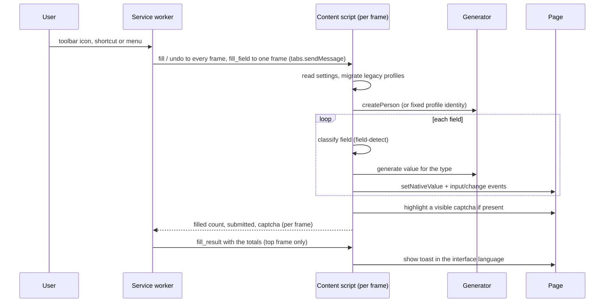

# Architecture

FillHub is a Manifest V3 Chrome extension. Its runtime has no dependencies and no build step: the
files in the repository are loaded as they are. npm is used only for development tools.

## Components

| Part | Files | Responsibility |
|---|---|---|
| Manifest | `extension/manifest.json` | Name and description via `__MSG_…__`, permissions (`storage`, `contextMenus`, `scripting`, `activeTab`), shortcuts; no content scripts are declared and no host permission is requested |
| Service worker | `extension/scripts/background.js` | Toolbar icon click, context menus (localized with `chrome.i18n`, including Settings), and shortcut commands; sends `fill` and `undo` to every frame of the tab together with its host (used by site exceptions), sums the replies and asks the top frame to show the result; sends `fill_field` only to the frame that was right-clicked |
| Backup | `extension/scripts/backup.js` (`FillHubBackup`) | Builds the export file and validates imported files field by field; the options page writes the result to storage |
| Site exceptions | `extension/scripts/site-rules.js` (`FillHubSiteRules`) | Normalizes host names and matches a page against the list of sites where auto-submit is off (subdomains included) |
| Diagnostics | `extension/scripts/diagnostics.js` (`FillHubDiagnostics`) | Builds the downloadable report from settings flags, counts and the last fill summary; never includes names, values, labels, profile names or site addresses |
| Locale data | `extension/scripts/locale-data.js` (`FillHubLocaleData`) | 15 language pools with Latin counterparts, 15 country profiles (cities, postal formats, phone rules, address templates, identity and IBAN specs) |
| Identity rules | `extension/scripts/id-rules.js` (`FillHubIdRules`) | Generators and validators for identity numbers; test vectors; PII sentinel values |
| Field detection | `extension/scripts/field-detect.js` (`FillHubDetect`) | Classifies a field from `type`, `autocomplete`, label, `name`/`id`, placeholder, `title`, `aria-label`; priority-ordered rules; number inputs accept only digit types (phone, postal code, ID); Turkish, Latin and non-Latin token matching |
| Generator | `extension/scripts/generator.js` (`FakeDataGenerator`) | Locale resolution, `createPerson`, value per field type, PII Safe values, persona migration |
| Content script | `extension/scripts/content.js` | Walks each accessible frame and shadow root, fills fields, handles checkboxes, radios, selects, dates, files, undo, toast, captcha notice |
| Settings page | `extension/options/options.html`, `extension/options/options.js`, `extension/options/i18n.js` | Profiles, custom rules, general settings, about, support; 15 interface languages; opened from the right-click menu |
| Styles | `extension/options/ui.src.css` → `extension/options/options.css` | Tailwind CSS 4 build (`npm run build:css`); generated file is not edited by hand |

Load order (`CONTENT_FILES` in `extension/scripts/background.js`; the service worker injects them on demand): locale data → identity rules → field detection →
generator → site rules → date picker → content script. Every file also exports to `module.exports`, so the unit tests load the
same code in Node.

## Fill flow

1. The service worker sends the action to every frame of the active tab; `fill_field` goes only to the frame
   that was right-clicked and targets its focused field (inside a shadow root too). Scripts are injected with
   `injectImmediately: true`: waiting for every frame to become idle would hang on a frame that never does
   (an `about:blank#…` iframe, for example).
2. The content script reads settings from `chrome.storage.local`. Legacy persona presets are migrated
   in memory, so the first fill after an update already behaves correctly.
3. For a full fill, one person is created per fill unless a fixed profile is active. The person is a
   plain JSON record, so it can be stored in a profile and reused.
4. Each field is classified and given a value. Writes go through one function, `setNativeValue`,
   which also notifies framework listeners.
5. Undo restores the values captured before the fill.

## Persons and PII Safe

- **Realistic mode**: names, city, postal code, phone and identity numbers follow the country profile.
- **PII Safe mode** (default): the same person model, but personal identifiers use test values: example
  domains (`example.com`, `example.org`, `test.example.com`), phones with an operator prefix and zeros,
  sentinel identity numbers with a valid checksum, and test street and company names.
- **Fixed profiles** store one person as JSON. PII Safe still applies to the identifiers when filling.

## Captchas

The content script never clicks, solves, or calls reCAPTCHA, hCaptcha, or Turnstile APIs. It only looks
for visible captcha elements after a fill, outlines the first one, and shows a notice. Invisible reCAPTCHA
(v3 and the invisible v2 badge) asks nothing of the user and is not counted, and neither is a widget hidden with CSS. It never scrolls to the
captcha or moves focus there. Before a fill starts, the service worker checks every frame of the tab for a visible
captcha and passes the result to all frames, so a captcha in any frame stops auto-submit in all of them. A captcha
that appears only after the fill, in a frame other than the form's own, is not seen.

## Settings and storage

- Settings and profiles live in `chrome.storage.local`. Nothing is synced or sent anywhere.
- Profile edits are saved only when the user presses **Save profile**.
- Interface strings: `extension/options/i18n.js` (identical key sets in all 15 languages; checked by tests).
  Element ids in `options.html` must match the keys, or the text is not applied.

## Tests

| Layer | Location | What it checks |
|---|---|---|
| Data verification | `tools/verify-data.js` | Known identity vectors, map integrity, 300 persons per country, translation parity |
| Unit | `tests/unit` | Field-detection corpus, generator diversity and PII values, persona migration, manifest, locales, privacy and captcha rules, release integrity |
| Browser | `tests/e2e` | Real Chromium with the extension loaded: fills, undo, PII modes, persona migration, profile dialog, captcha notice, settings page |

The browser tests also run against the unpacked store archive (`FILLHUB_EXT_DIR=…`), so the package
that gets published is the one that is tested.

## Host access

The manifest asks for `storage`, `contextMenus`, `scripting` and `activeTab`. There is no host permission.
`activeTab` gives access to the current tab only after a user gesture: a click on the toolbar icon (which fills
immediately), a keyboard shortcut, or a context menu item. Access ends when the user leaves the tab.

Consequences in the code:

- The toolbar icon has no popup. `chrome.action.onClicked` hands the tab it was clicked on to the same
  `runTabAction` path as a shortcut or menu item; that click is what grants `activeTab`. Changing the country
  or profile is done on the settings page, which opens with **Settings** in the right-click menu (the same item
  also appears when the toolbar icon is right-clicked).
- Shortcuts and menu items act on the tab they were used in.
- The e2e harness grants the permission the way a user does: `Ctrl+Shift+U` (Undo) on the form tab, then the
  fill runs against that tab. Chrome hides a tab's URL from extensions until such a gesture, so the harness
  finds the form tab among the active tabs, not by URL.
- Store listing (`store/listing/`), `store/privacy-policy.md` and `PRIVACY.md` describe `activeTab` and no
  longer mention `<all_urls>`. Keep them in step with the manifest; a unit test checks there is no `host_permissions`.
- `activeTab` grants host permission for the tab's main frame origin. Same-origin iframes are injected and filled;
  cross-origin iframes are not. The browser tests cover both cases (`frames` and `frames-cross-origin`).
